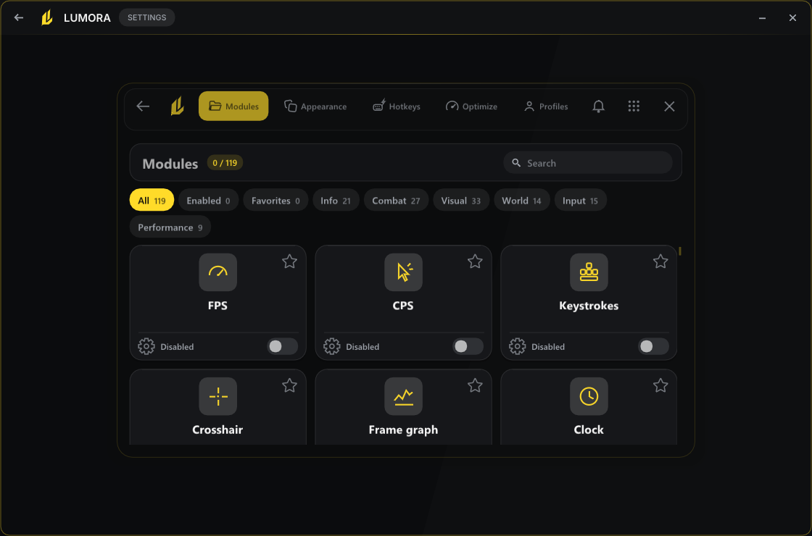

# Lumora Client for Minecraft Bedrock on Windows

Lumora Client is a customizable HUD client for Minecraft Bedrock Edition on Windows. Track frame times and clicks, move your coordinates and compass, and choose which of the 119 modules to enable.

**[Download for Windows x64](https://github.com/lumoramc/lumora-client/releases/latest/download/Lumora-Client-Installer.exe)** · [Release notes](https://github.com/lumoramc/lumora-client/releases/latest)

## Getting started

1. Open `Lumora-Client-Installer.exe`, choose an installation folder, and select the shortcuts you want. You can install Lumora without administrator privileges.
2. Open **Lumora Client** and select **Play**. If Minecraft is already running, the launcher connects to your game.
3. Once in a world, press **Right Shift** to open the menu. Choose your widgets under **Modules** and position them in the HUD editor. You can change the menu key under **Hotkeys**.

## Modules to try

| What you want to do | Where to start |
| --- | --- |
| Spot brief frame drops | Enable **FPS** and **Frame graph**. A spike on the graph shows when a frame took longer to render. |
| Track your clicking speed | Enable **CPS** and the click limiter. The first number shows accepted left clicks in the past second. Right clicks have their own counter. |
| See inside dark caves | Enable **Fullbright**. It adjusts world brightness and temporarily turns off smooth block lighting on supported builds. Switching it off restores your settings. |
| Switch between HUD layouts | Save a setup under **Profiles**. Each profile can have its own widget positions and appearance. |

## Compatibility

Lumora runs on 64-bit Windows with Minecraft Bedrock for Windows. The following 26.x package versions are supported.

| Minecraft for Windows package versions |
| --- |
| `1.26.6301.0`, `1.26.6201.0`, `1.26.6005.0`, `1.26.5203.0`, `1.26.5101.0`, `1.26.5004.0` |
| `1.26.4501.0`, `1.26.4403.0`, `1.26.4201.0`, `1.26.4005.0`, `1.26.3301.0` |

## Automatic updates

The launcher checks GitHub Releases at startup and every six hours while it is open. It downloads new versions in the background and verifies the file before installing. If you are playing, the launcher waits until you close Minecraft before restarting. You can check for updates manually or turn off automatic updates in launcher settings.
